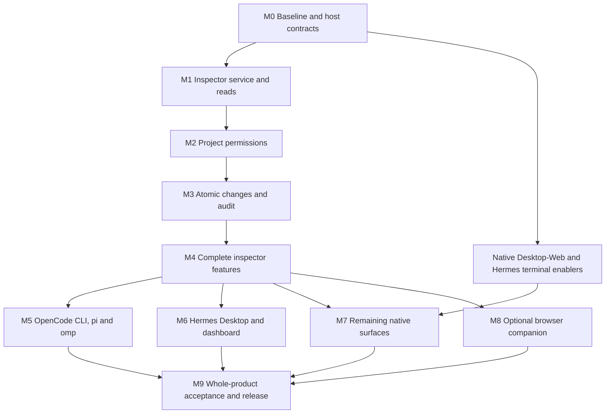

# Luminary Interactive UI Roadmap

## Goal

Make Luminary a visible, interactive memory-management system inside supported agent applications—not only hooks and notifications.

The complete product includes compact and full native inspectors, substantial controls organized into tabs, explicit project sharing, and a final Summary tab. One existing memory engine serves every UI. A browser companion and AI explanation are opt-in options, not hidden requirements or substitutes for native functionality.

**Status: shipped incrementally in `0.3.3` for the verified native surfaces; the whole-product goal is not complete.** OpenCode Web GUI discovery and Hermes terminal authority/lifecycle contracts remain blocked. `0.3.3` packages include the inspector for OpenCode CLI/Desktop, pi, omp, Hermes Desktop/dashboard and the explicit companion; they do not include those two blocked targets.

**Development checkpoint:** actual installed OpenCode CLI/Desktop, pi, omp, Hermes Desktop/dashboard and optional companion workflows have been exercised. Native switching, independent sharing rights, confirmed changes, transfer and offline Summary have evidence per exact host version. Passing local gates does not complete the two blocked native targets.

## Product decisions

| Area | Decision |
| --- | --- |
| Coverage | Plan every requested harness through completion, not one integration only. |
| Presentation | Both a compact conversation-side view and a full inspector, adapted to each host. |
| Organization | Related controls live in tabs. Summary is last. |
| Saving | Preserve current configured saving, curation and maintenance. UI installation/navigation changes none of these. |
| Sharing | Explicit project opt-in and configurable per-recipient-agent permissions. Edit/retract access is never implicit. |
| Summary | Deterministic data summary always works; AI explanation is separately requested. |
| Browser | Explicit optional companion, never automatic fallback or completion of a missing native panel. |
| Completion | Packaged working operations and actual host acceptance—not mockups, scaffolding, tool cards or manifest declarations alone. |

## Experience and tabs

### Compact view

Show active project/profile/server/store/agent, effective permissions, owned/shared status, bounded recent activity, actual committed/duplicate/skipped/error outcomes, warnings, and an entry to the full inspector.

The compact view remains useful during conversation. It does not cram every management control into a narrow sidebar.

### Full inspector

| Tab | Complete behavior |
| --- | --- |
| **Memories** | Search/filter/page, inspect ownership/status, create, explicitly correct/version, manage authorized tags/core designation and confirm retraction. Concurrent changes are not silently overwritten. |
| **Activity** | Actual recall, injection, durable save, duplicate, skip and error events with time/source. Distinguish current record snapshots, session episodes and new committed events. |
| **Evidence & History** | Grounding, provenance, validity, claim lineage, conflicts and authorized audit. Raw episodes require explicit expansion, not default bulk exposure. |
| **Relations** | Scoped graph or accessible adjacency view, supporting facts and bounded drill-down. Co-occurrence is not labeled causation or invented reasoning. |
| **Review & Maintenance** | Preview manual correction/conflict/maintenance effects before confirming. No new mandatory queue replaces configured automatic saving. |
| **Sharing & Workspaces** | Explicit project/location bindings, recipients, individual capabilities, revocation and effective access. Context switching clears stale data/actions. |
| **Settings & Diagnostics** | Effective supported values/configuration origin, secret presence, transport/backend/model readiness and separate data-quality diagnostics. No secret values or implicit all-profile changes. |
| **Data Transfer** | Authorized file selection, export coverage, import preview/confirmation, correct ownership/lineage and honest backup limitations. |
| **Summary** | Last tab: deterministic authorized totals, changes and unresolved issues at a visible reference time. Optional AI explanation identifies model, outbound data and available usage information. |

### Interaction requirements

- Every terminal action has a keyboard path; pointer support is verified per host.
- Tabs handle overflow/narrow layouts, resize, theme and Unicode without losing focus or selection.
- Empty, loading, denied, conflict, unavailable, unsupported, cancelled and unknown outcomes remain distinct.
- Closing restores conversation focus. Disable/reload/shutdown disposes listeners, timers, requests and registrations.
- An animation or optimistic card is not proof of a durable commit.
- Stored content, evidence and explanations remain untrusted data; they cannot activate controls or grant permissions.

## Target support matrix

Documented capability is not proof that Luminary's new implementation works on a particular installed release.

| Target | Native end state | Contract and completion gate |
| --- | --- | --- |
| **OpenCode CLI** | Compact session panel, full panel/page, shortcuts and all tabs/actions. | Development acceptance passed on **2.2.0** with installed resources, actual keyboard/pointer/resize, confirmed changes, sharing/transfer/settings, independent server-only execution, foreign-session denial and reload/removal. Registry publication and whole-product release gates remain separate. |
| **OpenCode Desktop** | In-application compact/full inspector. | Development acceptance passed on released **2.2.0**, using its [experimental GUI SDK](https://opencode.ai/docs/build/plugins/gui/): installed discovery, nine views, native confirmed edits, settings, independent grants/revocation, native file dialogs, duplicate import receipts, distinct remote-store authority, pending server-switch cancellation, keyboard navigation and GUI disable/reload without duplicate adapters. Full view is a native dialog, not a fullscreen route. Registry publication remains separate. |
| **OpenCode Web** | Host-native inspector using authorized connected-server data. | Actual authenticated **2.2.0** Web host lists the server plugin, but does not load its GUI command, panel or settings contribution. Needs a documented released third-party Web GUI loader; the SDK's `platform: "web"` type alone is not discovery. The optional companion does not satisfy this blocked native target. |
| **Hermes Desktop** | Dockable pane, full page, sidebar/settings and native controls. | Development acceptance passed on an official **0.22.5 source build**: compact/full views, nine projections, confirmed changes, persistent settings, native upload/download, authenticated remote REST, pending-request profile disposal, disabled-backend errors, return-profile rebind and independent Desktop-half reload. REST works without a healthy socket. Whole-product release gates remain open; the older bundled 0.22.0 SDK cannot load this adapter. |
| **Hermes web dashboard** | Host-native tab plus compact slots. | Actual **0.22.5** dashboard full views, read-only compact overview through the rendered `pre-main` slot, confirmed changes/sharing/transfer/settings, and pending-request profile disposal verified. Uses its own dashboard SDK and authenticated backend mount, not the Desktop SDK or standalone companion. Whole-product release gates remain open. |
| **Hermes CLI/TUI** | In-host compact/full terminal inspector. | Actual **0.22.5** command discovery works. Classic CLI documents protected wrapper hooks; Ink also discovers `$HERMES_HOME/tui-widgets/*.mjs` with ambient/modal rendering. Its widget SDK does not expose authenticated native session/profile/connection context or scope-change lifecycle. Needs that authority contract and normal-host integration before an inspector can safely claim native completion; commands or an unrelated wrapper/companion do not close the gate. |
| **pi** | Compact widget/in-chat rendering and full custom TUI. | Development acceptance passed on **1.4.0**: installed discovery, regular-mode keyboard/light theme, fullscreen pointer, all views, confirmed correction/retraction, grants/revocation, session-switch cancellation against a real locked SQLite store, JSON print/RPC and disposal. Compiled-JS updates required restart in the inspected bundled runtime. |
| **omp** | Compact widget and custom overlay/full inspector. | Development acceptance passed on **18.12.6/Bun1.4.4**, and re-verified on installed **18.18.5**: actual nine-view overlay, keyboard/resize/native theme, confirmed Unicode create/correct/retract, explicit grants/revocation, persistent preferences, native session reset, official parent/child/sibling factory isolation under a real SQLite lock, JSON print/RPC/headless and clean shutdown. The 18.18.5 re-check covered installed copy-extension discovery, `/luminary full` JSON state over a seeded store, headless RPC state delivery and UI-enabled nine-dialog RPC. Pointer support is not claimed. |
| **Browser companion** | Complete inspector when explicitly launched. | Installed-wheel development acceptance passed: actual authenticated browser, nine views, confirmed versioned edits, offline Summary, scoped compact permissions, real download/upload and duplicate receipts. Real-time sign-in/session expiry, signout revocation, CSRF/origin/Host checks and forged context/file refusal verified. It remains optional, loopback-only and never substitutes for a native target. |

Server plugins, terminal plugins, providers, Hermes Desktop/dashboard and ordinary agent plugins have different entrypoints. A generic single export does not establish all surfaces.

## Architecture and authority

### One engine, multiple native renderers

Reuse `MemoryClient`, existing retrieval/ingestion, SQLite/pgvector and provider/bridge integrations. Add one inspector service for authorized projections and explicit operations. Frontends never open databases or implement another memory engine.

Share operation meanings and state/error contracts, not an incompatible universal widget tree or duplicate host renderer/React runtime.

### Trusted native context

- Resolve user/profile/project/agent/session/host/store on the server from trusted native context.
- Frontend fields and recalled text cannot authorize another user, DB, scope or grant.
- Remote UI uses the remote host's configured backend; failure never silently switches to a local/unbound store.
- Missing identity fails closed. Global/legacy read compatibility is not project sharing.
- Initially support one trusted owner per backend deployment. Arbitrary multi-user hosting needs independently verified principal binding.
- Extensions with owner-level OS access are not sandboxed by memory permissions; do not claim otherwise.

### Explicit project sharing

Stable owner-approved project identity and location bindings are required. Matching folder names, Git URLs or usernames across machines is insufficient. Separate stores are not magically shared: require an explicitly configured common backend/context, not SQLite over unverified network/SSHFS locking.

| Capability | Meaning |
| --- | --- |
| Read | Inspect explicitly authorized resources and their permitted projections. |
| Contribute | Add under the contributing agent's own identity; does not imply read/edit/retract rights or transfer ownership. |
| Edit | Explicit permission to correct/version selected shared resources. |
| Retract | Explicit permission to retract selected shared resources. |

Only verified owner interaction administers grants. Preserve original record IDs/ownership; do not copy facts or remove agent predicates. Recheck rights per operation and inside writes. Policy changes invalidate cursors, cached authorization and pending work.

Revocation blocks subsequent reads, exports, explanations and changes and clears usable inspector content where feasible. It cannot retroactively remove information already delivered.

### Truthful data and mutations

- Browse/refresh/deterministic Summary do not ingest, maintain, call models or mutate access bookkeeping.
- Scope filters precede ranking, aggregation and limits for cards, evidence, history, graphs, counts, audit, transfer and AI payloads.
- Bound page/expansion/graph work and serialized payloads. Context/filter/policy-bound cursors cannot be reused across selections.
- Changes use content revisions and explicit preview/confirmation where appropriate. Stale changes produce conflict, not last-write-wins.
- Successful inspector changes commit memory/claims/index state and durable audit together. Self-committing helpers require genuine transaction-aware integration.
- Export publication and native profile files are not atomic with SQL. If external persistence starts or a successful mutation loses its commit acknowledgement, report an unknown outcome, discard the pending UI proposal and require inspection before any new attempt; do not claim rollback or automatically replay it.
- Audit retains scope after a record disappears. Unverifiable legacy history is not exposed globally.
- Event cursors/replay distinguish durable outcomes from running/cancelled/unknown operations and do not count snapshots as new writes.

### Configuration, secrets and optional AI

Never return raw Settings/config objects, API keys, credential-bearing DSNs or other profiles' secrets. Show presence/status through host-managed secret facilities.

Installing/enabling/opening UI must not select a provider, edit other profiles or change current save enablement, grounding, cadence and session continuity.

Deterministic Summary uses actual authorized data and a visible reference time. AI explanation is read-only, explicitly requested and disclosed: provider/model/destination/outbound fields and known usage/cost availability. Disabled/offline/failed AI does not break normal Summary. It cannot authorize tools, writes or permissions.

### Observed implementation checks

- **Backend:** the full official Hermes SDK plus independent installed-wheel consumer suite passed **703 tests**, with one known Windows0600 permission case deselected and one upstream Starlette deprecation warning. The real PostgreSQL inspector matrix passed **104 tests**; two cases were inapplicable or covered by the separate installed-consumer gate.
- **View state:** **21** shared/native-controller checks passed, including stale-context rejection, native confirmation, unknown outcomes and file-upload cancellation. Two forwarding-only tests were removed rather than treated as behavioral proof.
- **Actual surfaces:** the target matrix records exact installed host versions and native input, changes, permissions, transfer and lifecycle evidence. Companion observations never count as native Web or terminal support.
- **Scale:** an installed in-process SQLite service was measured with 20,000 memories, 10,000 authorized records and 33,600 graph edges. Browse/graph output stayed bounded, cursor pages did not overlap, foreign data stayed absent and Summary counted only the authorized scope. These are service measurements, not UI-latency or embedding-throughput claims.
- **Build and regression gates:** local wheel/source/native-package builds, strict SDK/browser TypeScript checks and Ruff passed. The unchanged real default-embedding-model gate passed all five cases; a separate deterministic 400-cycle soak had zero control misses or no-answer leaks.
- **Release boundary:** none of this establishes a published inspector, approved catalog listing, completed AI-model evaluation or whole-product completion.

## Delivery sequence

Supported integrations may ship incrementally, but partial shipment is not whole-product completion. Missing native SDK targets stay visible and open.

### M0 — Reconciled baseline and verified host contracts

**State:** baseline and tested host contracts verified locally; the remaining upstream dependencies are named in M7.

Released native integrations and subsequent `develop` operator-config/OpenCode-skill fixes are incorporated into the implementation baseline. Existing release artifacts are unchanged. New native surfaces are not considered verified from a build or manifest alone.

Deliver:
- Reviewed execution baseline and passing existing safety/backend/package gates.
- Exact tested host releases, entrypoints, install/input/headless/remote contracts.
- Bounded upstream-enabler work for native OpenCode Desktop/Web and rich Hermes terminal, started alongside independent supported work.

**Exit:** required APIs verified; missing seams have evidence, ownership and completion conditions. No invented SDK or assumed version range.

### M1 — Shared inspector service and bounded reads

Deliver canonical requests/results, trusted context/store/project binding, filtered/paged non-mutating browse/detail/evidence/history, safe projections, explicit expansion, bounded payloads and context-bound cursors.

**Exit:** SQLite and real pgvector return exactly authorized records across users/projects/agents. Refresh changes neither memory/access bookkeeping nor saving. Missing/forged identity and stale cross-context cursors fail closed; backend failure is not an empty healthy result.

### M2 — Opt-in sharing and permission administration

Deliver explicit per-project recipient rights, effective-permission data, policy revision, scoped grant audit and revocation covering pending requests/caches/events/exports/explanations. Keep IDs and ownership unchanged.

**Exit:** each capability is tested independently. Contribute cannot mutate another agent's record. Foreign IDs/labels/counts/audit/evidence do not leak; revoked queued work cannot deliver stale authorized-looking output.

### M3 — Safe changes, history and actual activity

Deliver confirmed create/correction/tag/core/conflict-resolution/retraction, content revision checks, atomic domain/index/audit transitions, scope-retaining event history and snapshot/live reconnect semantics.

**Exit:** two editors cannot silently overwrite each other; a new conflicting claim also invalidates an older resolution preview. Failed audit leaves no acknowledged partial change. Cancellation/timeout do not become fabricated success or destructive replay. Snapshot rows never count as new saves.

### M4 — Complete feature projections and shared view state

Deliver:
- Real service operations for every semantic tab, with honest availability.
- Bounded graph drill-down/supporting facts and actual recorded recall/injection evidence.
- Manual review/maintenance previews without new automatic-save rules.
- Safe effective configuration, secret presence and separately labeled readiness/data quality.
- File-handle-based export/import preview, confirmed transfer, accurate format coverage and tested lineage mapping.
- Deterministic final Summary and optional read-only AI explanation with disclosure/consent.
- Shared controller with context epochs, stale-result rejection, permissions and cancellation; separate native renderers.

**Exit:** all tab operations use actual authorized data. Failures are not disguised as empty/healthy views. AI-off Summary works offline; no hidden model call, invented reasoning or credential enters a response.

### M5 — OpenCode CLI, pi and omp native inspectors

**State:** verified in development on OpenCode 2.2.0, pi 1.4.0 and omp 18.12.6/Bun 1.4.4; publication remains separate.

Deliver:
- OpenCode server typed RPC and separate packaged TUI entrypoint; compact session panel and full inspector.
- Pi compact widget/in-chat view and full custom TUI, honoring its own mode/focus lifecycle.
- Omp widget/overlay/full inspector with session-local state and its own input/mode contracts.
- Commands/shortcuts, all tabs/actions, narrow layouts, themes and keyboard paths.
- Complete wheel/package/copy-install resource graphs without repo-only imports or duplicate obsolete adapters.
- Actual OpenCode CLI used remote RPC with unavailable client Python and a
  different local database; writes and transfers stayed on the selected server.
  Foreign-location and missing sessions were denied. Pi and omp exercised their
  own native modes, confirmed edits, sharing/revocation and session disposal.
  Exact versions and host-specific limits are recorded in the target matrix.

**Exit:** installed native hosts demonstrate every tab, confirmed changes, sharing restrictions, Summary, resize, restored focus, reload/removal and session switching. Remote OpenCode uses remote memory. Headless/RPC/JSON/print do not attempt custom terminal UI and retain supported nonvisual operations.

### M6 — Hermes contracts, Desktop and dashboard

**State:** verified in development on official 0.22.5 SDK/dashboard and an unmodified Desktop source build; the older bundled 0.22.0 Desktop SDK remains incompatible.

Deliver typed provider config and CLI consumer, scoped secrets/context workers, actual storage roundtrip, separate provider/backend/frontend enablement, native Desktop pane/page/sidebar/settings, and independent host dashboard tab/slots/API mounting.

Account for app-level local Desktop installation versus profile-scoped remote backend installation. REST refresh remains sufficient where plugin sockets are unavailable; backend restart requirements are explicit.

**Exit:** real host/SDK tests—not only stubs—prove controls, secrets, profile storage and unchanged saving. Desktop and dashboard both demonstrate all tabs, delayed profile/remote switching, confirmed changes, settings persistence, disabled-backend behavior and teardown.

### M7 — Remaining native extension surfaces

**State:** OpenCode Desktop 2.2.0 is verified. OpenCode Web GUI discovery and Hermes terminal authenticated context/lifecycle remain blocked; rendering types or visual widgets alone do not close them.

Deliver:
- Supported native OpenCode Desktop and Web loader/contribution/context/input/lifecycle/package contracts.
- Supported rich Hermes CLI/TUI rendering contract.
- Complete Luminary renderers through those actual released/documented seams.
- Upstream-compatible enabler contributions where needed, not private forks or runtime core/DOM patches.

**Exit:** Desktop, OpenCode Web and Hermes terminal each demonstrate compact/full native operation and equivalent data/action semantics. Commands, server tool cards, another host or a companion browser do not close these rows.

If upstream support is unavailable, keep the exact dependency and target incomplete. Do not silently weaken the goal or promise dates controlled by another project.

### M8 — Explicit optional browser companion

**State:** installed-wheel/browser development acceptance verified, including real-time expiry, revocation, forged-context/file refusal and actual download/upload.

Deliver the complete inspector over the same service/permissions, packaged local frontend, optional dependencies, explicit launch/context selection and authenticated loopback transport with short-lived session setup, same-origin/CSRF checks and safe file handles.

No server/browser starts on import, install, ordinary agent startup or native UI failure. No permissive CORS or browser-selected DB/user identity.

**Exit:** real browser/service/storage prove full operations, expiry/revocation, unauthenticated/cross-origin denial, context isolation, safe stop and unchanged native/retention behavior. Optional means opt-in at runtime, not an unfinished stub or native-support claim.

### M9 — Whole-product acceptance and release

**State:** `0.3.3` publishes the verified inspector surfaces and keeps the whole-product goal open. M7 remains blocked for the two native targets, so M9's complete acceptance criteria are not met and this release does not claim them.

Deliver:
- SQLite/real-pgvector inspection, sharing, concurrency, audit, graph, transfer, settings and Summary coverage.
- Existing Python/native-package safety suites and unchanged real default-embedding-model release gate.
- Actual packed-package/wheel install/update/remove acceptance without source-only imports.
- Exact supported-host/input/remote/headless matrix and secret-free visual/operation evidence.
- Measured large-store responsiveness: bounded work, cancelled stale searches and explicit expensive-diagnostic state; no whole-store scan per keystroke or invented performance claim.
- Accurate registry/catalog metadata, actual publication proof, generic structured release notes and usage/permission documentation.

**Exit:** every required native row and cross-cutting gate passes. Useful incremental releases do not erase unfinished native targets.

## Acceptance matrix

| Scenario | Required outcome |
| --- | --- |
| Two users/projects/agents plus global/partial rows | Authorized records/aggregates only; guessed IDs and forged scope denied. |
| Share/contribute/edit/retract/revoke | Independent rights, unchanged ownership and revoked pending work denied. |
| Concurrent writes or audit/index failure | No silent overwrite, broken lineage or acknowledged partial commit. |
| Context switch during requests | No old content/actions enter a new profile/project/server. |
| Refresh/reconnect/replay | No extra writes/AI calls, duplicate activity counts or hidden gaps. |
| Empty/backend failure/timeout/cancel | Distinct honest states, no false saved status or destructive replay. |
| Saving on or off | UI leaves configured behavior and unrelated profiles untouched. |
| AI off/offline/revoked snapshot | Deterministic Summary works; no automatic/unauthorized outbound call. |
| Transfer with foreign IDs/version chains | Authorized preview/confirmation, correct or explicitly rejected lineage, no fake full-backup claim. |
| Install/update/remove/reload | Complete resources, no duplicate hooks or leaked listeners/dependencies. |
| Keyboard/supported pointer/narrow/theme | Complete usable workflows and restored conversation focus per actual host. |

## Dependencies and risks

| Dependency/risk | Required response |
| --- | --- |
| Main/develop divergence | Reconcile separately before implementation; roadmap-only publication preserves existing code. |
| Missing native SDK | Named upstream enabler and evidence; no invented API/browser substitution. |
| Hermes discovery differences | Verify every entrypoint, enablement and API mount with the real host. |
| Scope-less old audit/incomplete export lineage | Never infer authority; label limitations and test verifiable migration/roundtrip. |
| Secrets, remote context and principal binding | Use trusted host authority/secret routes; no unproved multi-user safety claim. |
| Self-committing helpers/concurrent writers | Genuine transactional revision/audit handling, not a cosmetic wrapper. |
| Large graphs/stores or noisy feeds | Bound/page/cancel work and measure actual performance. |
| Registry/catalog/release authorization | Verify independently of builds; no hardcoded future version/date or false website visibility. |

## Progress and final definition of done

Use **planned**, **in progress**, **blocked**, **verified** and **released** distinctly. Verified requires observable behavior; released additionally requires an installable artifact and truthful support documentation.

Complete means:
- Every semantic tab backed by real authorized operations.
- Compact/full native acceptance on every requested surface.
- OpenCode Desktop/Web and Hermes terminal native gates genuinely closed, not hidden by fallback.
- Browser and AI options usable when chosen and inert otherwise.
- Existing saving preserved.
- Sharing, safe changes, scoped history, secrets and honest failures proved on both backends.
- Packaging, lifecycle, input/accessibility and publication checks complete.

## References

- [Released native integration baseline](https://github.com/alertxsto/luminary-memory/blob/main/docs/agent-integrations.md)
- [API](api.md), [architecture](architecture.md), [backends](backends.md), [configuration](config-reference.md)
- [OpenCode CLI UI](https://opencode.ai/v2/docs/build/plugins/cli/) and [typed RPC](https://opencode.ai/v2/docs/build/plugins/rpc/)
- [Inspected published OpenCode SDK 2.2.0](https://unpkg.com/@opencode/plugin@2.2.0/package.json) and [experimental GUI contract](https://opencode.ai/docs/build/plugins/gui/)
- [Hermes Desktop SDK](https://hermes-agent.nousresearch.com/docs/developer-guide/desktop-plugin-sdk), [dashboard SDK](https://hermes-agent.nousresearch.com/docs/user-guide/features/extending-the-dashboard), [memory-provider contract](https://hermes-agent.nousresearch.com/docs/developer-guide/memory-provider-plugin)
- [pi extensions](https://github.com/badlogic/pi-mono/blob/main/packages/coding-agent/docs/extensions.md) and [terminal UI](https://github.com/badlogic/pi-mono/blob/main/packages/coding-agent/docs/tui.md)
- [Inspected versioned omp contract](https://github.com/can1357/oh-my-pi/blob/v18.12.6/packages/coding-agent/src/extensibility/extensions/types.ts)

Versioned links are evidence references, not permanent compatibility floors or future release numbers. Revalidate actual supported releases before implementation/publication.

## Conclusion

Deliver one trustworthy memory-management experience with native visual integrations, explicit user control and consistent semantics. Browser and AI enrich it only when requested. The goal is complete when native targets, real operations, permissions and packaged lifecycle work—not when hooks merely display more text.
